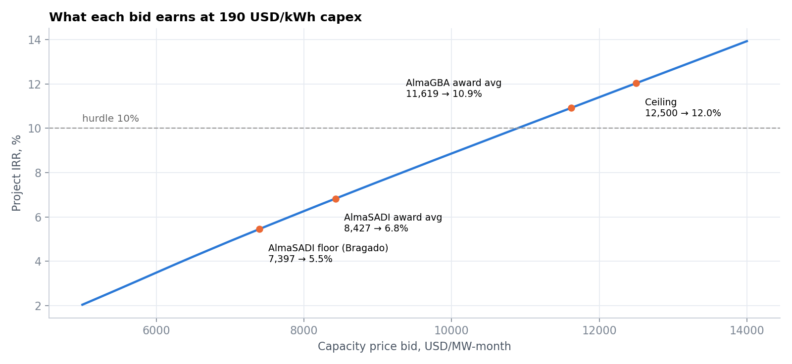
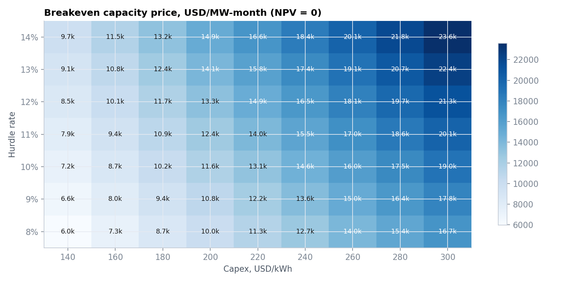
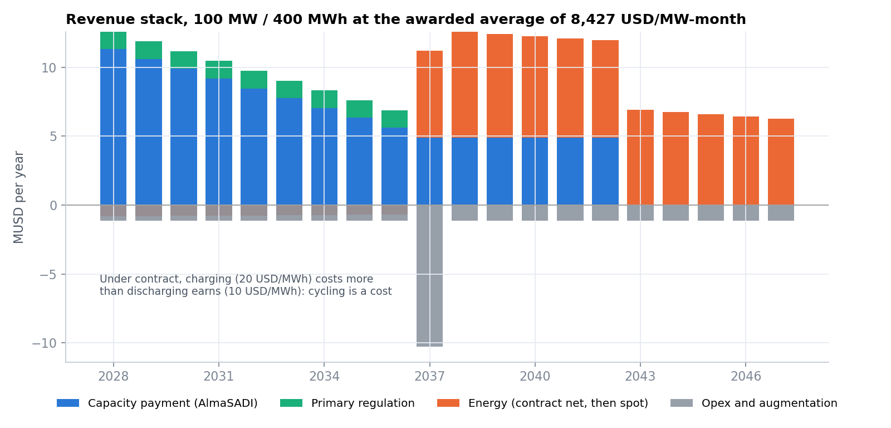
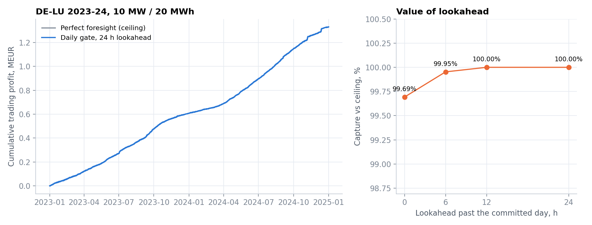

# Argentina BESS valuation: what an AlmaSADI bid is worth

Valuation model for a **100 MW / 400 MWh battery** bidding into Argentina's storage tenders (AlmaSADI, AlmaGBA) under the new wholesale market rules of **Res. SE 400/2025**. It combines Pyomo/HiGHS dispatch on real CAMMESA demand data with a project-finance model (sculpted debt, tax, augmentation) and Monte Carlo.

> **ES:** Modelo de valuación de un BESS de 100 MW / 400 MWh para las licitaciones AlmaSADI y AlmaGBA. Despacho óptimo (Pyomo + HiGHS) sobre demanda real de CAMMESA, flujo de fondos con deuda esculpida y Monte Carlo. Responde: ¿qué TIR implica cada oferta y cuál es el precio de equilibrio por MW-mes?



## Key results (base case, all inputs editable)

| | |
|---|---|
| Breakeven capacity price at a 10% USD hurdle | **≈ 10,890 USD/MW-month** |
| Project IRR at the AlmaSADI award average (8,427) | **6.8%** |
| Project IRR at the AlmaSADI floor bid (7,397) | 5.5% |
| Project IRR at the AlmaGBA award average (11,619) | 10.9% |
| Monte Carlo project IRR at 8,427 (P10 / P50 / P90) | 3.2% / 6.4% / 9.7% |
| Debt sculpted to DSCR 1.30 | 56% gearing |
| Contract cycling, base case | 150 cycles/yr (dispatch by need, see below) |

**Reading.** At 190 USD/kWh all-in, the AlmaGBA awards clear a 10% USD hurdle. The AlmaSADI awards, about 27% lower, do so only if all-in capex is near **155 USD/kWh**, or if bidders accept a lower cost of capital or a richer post-2037 spot tail than the long-run price levels assumed here (average CMg about 72 USD/MWh). The breakeven grid below shows the trade-off. Under the contract, cycling costs the owner money (charging is billed at 20 USD/MWh and discharging pays 10), so the capacity payment carries the project, and the less CAMMESA cycles the battery, the better for the owner.

## How CAMMESA actually dispatches contracted batteries

At the AlmaGBA operating workshop (CAMMESA and SACME, 8 October 2026, with Edenor, Edesur and the awardees), CAMMESA described the operating model for the **683 MW of firm capacity in 11 plants** (470 MW in Edenor's area, 213 MW in Edesur's):
- dispatch is planned **weekly**, from the demand forecast and network state;
- a battery is brought into service when **lines or transformers exceed 85% of capacity**;
- indicative windows: discharge at the **winter night peak** and the **summer afternoon peak**, and charge in the **early-morning valley**;
- the batteries are being integrated into CAMMESA's **AGC** (automatic generation control) for closed-loop setpoints.

So contracted storage is cycled **by need, not by daily price arbitrage**. The base case assumes 150 full cycles a year in seasonal peak windows. The price-driven daily dispatch from the LP (about 400 cycles a year) is kept as the conservative bound:

| Contract cycling | Cycles/yr | Project IRR at 8,427 | Breakeven bid |
|---|---|---|---|
| Critical days only | 60 | 7.3% | 10,520 |
| **Seasonal peak windows (base)** | **150** | **6.8%** | **10,890** |
| Most weekdays | 250 | 6.3% | 11,310 |
| Price-driven daily (LP) | ~400 | 5.5% | 11,930 |




## Method

1. **Data.** CAMMESA's public demand API (5-minute SADI demand, the latest ~6 months, resampled to hourly) and Fraunhofer ISE Energy-Charts (DE-LU day-ahead prices, CC BY 4.0). `data/fetch_data.py` downloads both. The DE-LU prices are included in the repo under their CC BY 4.0 licence; the raw CAMMESA demand file is not redistributed, so run the fetch script first (the API only serves the most recent ~6 months, so a fresh download covers a later window than the committed results).
2. **Price signal.** CAMMESA does not publish hourly marginal prices through an open API, so the hourly CMg is a **merit-order proxy**: price ∝ demand^3 within each month, scaled to a monthly reference CMg. Under Res. 400 the spot price a GUDI pays is CV + FSA × (CMg − CV); new merchant capacity is valued at full CMg. Swap in real CAMMESA hourly CMg with `prices.load_price_csv()`. The 2026 dispatch window is scaled to 2026 monthly levels, which include the Q2 fuel price spike. The post-2037 spot tail is valued at long-run levels, about 72 USD/MWh on average.
3. **Dispatch** (`src/bess/dispatch.py`). Used for the spot tail and as the upper bound on contract cycling. The LP maximises Σ price × (discharge − charge) − degradation, with SoC dynamics and round-trip losses. Binaries for charge/discharge exclusivity are added only in negative-price hours, the only hours where both at once could pay. The model is solved as one gate per local delivery day with SoC inherited from the previous gate, or as a single perfect-foresight window. Clock-change days (23 h / 25 h) are handled on a UTC index.
4. **Contract.** AlmaSADI terms (Res. SE 50/2026, Res. 155/2026), as summarised by Marval O'Farrell Mairal and Tavarone:
   - capacity price ≤ 12,500 USD/MW-month × an annual factor (1.30 in 2026, falling to 0.50 for 2037–2041);
   - 10 USD/MWh for discharged energy and 20 USD/MWh for charging energy;
   - 5 USD/MWh for primary regulation on ≥30% of power;
   - availability penalties capped at 80%;
   - energy and regulation paid at spot from 2037.
5. **Finance** (`src/bess/finance.py`). Annual cash flows include degradation and augmentation, tax under RIGI (25%) or the general regime (35%), and debt sculpted to a target DSCR and capped at maximum gearing. Outputs are IRR, NPV, LCOS and a bisection solve for the breakeven bid.
6. **Uncertainty.** 2,000 Monte Carlo draws on capex, availability, debt rate, spot margin and contract cycling (60–400 cycles a year).

## International benchmark: DE-LU 2023–2024

The same dispatch engine was run on 17,544 hours of German day-ahead prices for a 10 MW / 20 MWh battery:
- **Perfect foresight:** 1.330 M EUR, about 66,400 EUR/MW-year.
- **Daily gate, 24 h lookahead:** captures 99.99% of that.
- **No lookahead:** captures 99.7%.

The perfect-foresight result reproduces an independent backtest of the same case to within 0.03%.



## Run it

```bash
conda env create -f environment.yml && conda activate energy-portfolio
python data/fetch_data.py          # CAMMESA demand + DE-LU prices
python run_argentina.py            # valuation, figures -> results/
python run_benchmark_delu.py       # ~10 min, international benchmark
streamlit run app.py               # interactive bid explorer
```

## Limitations

- The hourly price shape is a proxy. Real nodal CMg, congestion and the dispatch CAMMESA actually orders (reserve-driven, not price-driven) will differ.
- The steps of the annual factor between 2026 and 2037 are interpolated. Check them against the pliego.
- Only ~6 months of demand are served by the API. Unobserved months are filled by price level.

## Sources

- Res. SE 400/2025 (Boletín Oficial, 21-10-2025): MEM normalisation rules.
- Res. SE 50/2026 (AlmaSADI call) and Res. SE 155/2026 (award of 700.5 MW, 20 projects).
- Marval O'Farrell Mairal, *Convocatoria AlmaSADI: acuerdos de almacenamiento de energía* (2026).
- CAMMESA/SACME, *Jornada sobre aspectos operativos de la Convocatoria AlmaGBA* (8 Oct 2026): 683 MW in 11 plants, 85% loading trigger, AGC integration.
- pv magazine Latam, AlmaGBA award (Sept 2025) and AlmaSADI award (July 2026). Review Energy, AlmaSADI bid statistics (2026).

---
Pedro Schiaffi · [LinkedIn](https://www.linkedin.com/in/schiaffipedro) · MIT licence
